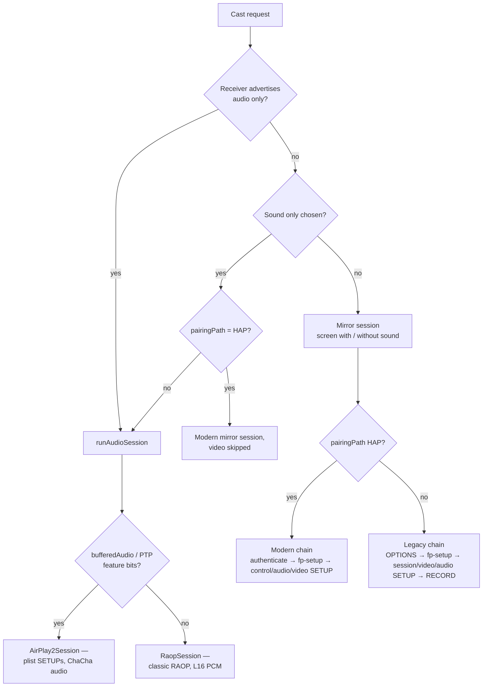

# Agent Instructions for Kite

## Project Context

Kite (`com.henry.kite`) is an Android AirPlay **sender**: it mirrors the
phone's screen — and plays its audio — on AirPlay receivers (Macs, Apple TVs,
open receivers like UxPlay). It is not a receiver.

**Stack**:

- Kotlin 2.3 / AGP 9.2 / Gradle 9.6, `compileSdk 37`, `targetSdk 36`,
  `minSdk 29` (a functional floor — see Constraints)
- Jetpack Compose (Material 3), DataStore, JmDNS, Bouncy Castle
- Modules: `airplay` (protocol, pure Kotlin/JVM-testable), `capture`
  (MediaProjection → H.264, AudioRecord → AAC/ALAC), `app` (UI + service)

**Protocol work**: the modern (HAP-paired) sender flow is a Kotlin port of
[doubletake](https://github.com/omarroth/doubletake) (Go); the legacy path
follows [UxPlay](https://github.com/FDH2/UxPlay) / pyatv. Ported files cite the
Go function they mirror — keep it that way.

## Repository Structure

```
/
├── airplay/                      # Protocol module — no Android UI dependencies
│   └── src/main/java/com/henry/kite/airplay/
│       ├── crypto/               # ChaCha20-Poly1305 (both layouts), HKDF-SHA512, SRP-6a
│       ├── discovery/            # JmDNS + BLE beacon discovery, feature flags
│       ├── pairing/              # HAP pair-setup / pair-verify, TLV8, legacy pairing
│       ├── plist/                # Binary plist reader + writer
│       ├── rtsp/                 # RTSP client, digest auth, encrypted channel
│       └── session/              # Session orchestration + stream layers
│                                 #   MirrorSession / ModernSessionSetup / SetupRequests
│                                 #   MirrorStream (video) / AudioStream (legacy)
│                                 #   ModernAudioStream / AirPlay2Session / RaopSession
│                                 #   Fairplay*.kt / FpsapSession.kt (SAP v3 port)
├── capture/                      # MediaProjection → H.264; AudioRecord → AAC/ALAC
├── app/                          # Compose UI, MirrorService (FGS), settings, tile, logs
└── images/                       # README screenshots
```

## Build & Test Commands

```sh
./gradlew :app:assembleDebug     # build the APK
./gradlew test detekt            # all JVM unit tests + static analysis
./gradlew :airplay:testDebugUnitTest --tests "com.henry.kite.airplay.crypto.*"
adb install -r app/build/outputs/apk/debug/app-debug.apk
```

## Key Development Rules

### 1. Every cast takes one of five chains — know which one you are touching

Routing lives in `MirrorService.handleStart` / `runAudioSession`; sessions live
in the `airplay` module. Chain selection is explicit:



| Chain | Receiver | Session class | Audio pipeline |
|-------|----------|---------------|----------------|
| Modern mirror | macOS, Apple TV (HAP) | `MirrorSession` + `ModernSessionSetup` | `AlacAudioEncoder` → `ModernAudioStream` |
| Legacy mirror | UxPlay, other open receivers | `MirrorSession` + `setupLegacySession` | `AlacAudioEncoder` → `AudioStream` |
| Sound-only (HAP) | macOS | `MirrorSession` with `videoEnabled=false` | same as modern mirror |
| AirPlay 2 audio-only | HomePod-class (bufferedAudio/PTP bits) | `AirPlay2Session` | `AlacAudioEncoder` |
| RAOP audio-only | classic AirPlay 1 receivers | `RaopSession` | `AudioPcmSource` (L16) |

Full phase-by-phase breakdown with sequence diagrams: CONTRIBUTING.md §Casting
architecture.

### 2. The modern chain order is protocol-significant

For HAP receivers the order is **pair-verify → fp-setup → SETUPs**: macOS
answers 403 to everything from an unpaired client, so pairing runs first and
the rest travels on the encrypted control channel. In `ModernSessionSetup` the
order is control SETUP (PTP, NTP fallback) → video SETUP (type 110, PD-mixed
`shk`/`shiv`) → audio SETUP (type 96, ALAC, random `shk`, `streamConnections`)
→ volume ×2 → RECORD unless the control response asked to skip it. Video is
optional (`videoEnabled=false` ends the session at the audio phase — that is
what sound-only uses). Do not reorder or conditionally skip phases; each
response seeds the next step (eventPort, ports, ClockID anchor, skipRecord).

### 3. Protocol bodies live in SetupRequests / ModernSetupRequests — and are pinned by tests

All RTSP plist bodies are built in `session/SetupRequests.kt` (legacy) and
`session/ModernSetupRequests.kt` (modern). Adding or changing a field means:
extend the builder + extend `SetupRequestsTest`, which parses the built bytes
back through `BinaryPlistReader` and asserts every field receivers dispatch on
(ct, spf, audioFormat bit, shk length, streamConnections shapes).

### 4. Crypto keys are established at their phase — never re-derived ad hoc

| Material | Established by | Consumed by |
|----------|----------------|-------------|
| Video channel key (modern) | HKDF-SHA512(pair-verify shared secret, `"DataStream-Salt<connectionId>"`, `"DataStream-Output-Encryption-Key"`) | `ChaChaFrameCipher` (IETF 12-byte nonce) |
| Video/audio stream keys (legacy) | FairPlay `fp-setup` → `StreamCipher` | `MirrorStream`, `AudioStream` (AES) |
| Screen-audio key (modern) | random 32-byte `shk`, published in the audio SETUP descriptor | `ModernAudioStream` — draft-agl ChaCha20-Poly1305 (`OriginalChaCha20Poly1305`): 8-byte LE nonce appended after the tag, AAD = RTP timestamp + SSRC |
| Pairing | SRP-6a / Ed25519 / X25519 (`pairing/`, `crypto/`) | HAP flows |

Crypto changes require golden vectors generated by the implementation the
receivers interoperate with — self-consistent implementations can agree with
each other and still disagree with every receiver. Regeneration recipe
(offline, uses the Go module cache):

```sh
# in a clone of doubletake (its go.sum resolves the modules from the cache)
GOFLAGS=-mod=mod GOPROXY=off go run ./tmpdir
```

### 5. Stream classes own their medium end-to-end

`MirrorStream` (video TCP channel, 128-byte headers via `MirrorPacket`,
`NaluRepacker` for avcC config), `AudioStream` (legacy RTP), `ModernAudioStream`
(modern RTP), `EventChannel`, `TimingServer`, `AudioControlServer` — each owns
its socket, cipher, heartbeat/retransmit handling and close semantics. The
service only pumps encoded frames in; new stream behavior belongs in the stream
class, not in `MirrorService`.

Load-bearing details in the modern audio stream (read the class comment before
touching): PT 0x60, SSRC=0, 352-sample RTP step, each frame replayed as
`[N-2, N-1, N]` byte-identically, TimeAnnounce (PT 0xd7) at the first frame and
once per second, 0xd5/0xd6 retransmit responses.

### 6. Media capture

- Video (`ScreenEncoder`): VBR with the explicit `"max-bitrate"` string key
  (`KEY_MAX_BITRATE` does not exist in the SDK). `AVCLevel52` with a 4.1
  fallback. Rotation rebuilds the encoder and re-primes the receiver via the
  codec-config path; use `liveWidth`/`liveHeight` for that geometry, never the
  startup `format`.
- Audio: every path captures through `AudioPlaybackCaptureConfiguration` using
  the **same** MediaProjection as the video capture. The encoder is created
  only when RECORD_AUDIO is granted and a stream exists; otherwise the session
  runs video-only instead of failing.
- Legacy receivers get **ALAC** (ct=2, 352-sample frames) — receivers validate
  AAC-ELD frame headers against Apple-encoder first bytes and drop frames from
  other encoders.
- Bit-rate bounds span two modules: `MirrorSettings.BIT_RATE_MAX_MBPS` (slider)
  and `VideoFormat.BIT_RATE_MAX_BPS` (encoder `require()`). Change one, change
  the other — `MirrorSettingsTest` asserts their consistency.

### 7. Discovery

- `_raop` resolve callbacks in JmDNS do not fire — audio-only capability comes
  from recording `_raop` instance names at `serviceAdded` and matching the
  `_airplay` TXT `deviceid` against them (strip `:` from both sides).
- One receiver, one entry: merge mDNS services by `host:port`; IPv4 supersedes
  IPv6 for the same deviceId. List keys are `host:port` — never `stableId` or
  `deviceid`.
- BLE entries appear only after `GET /info` enrichment succeeds **and** the
  receiver advertises screen mirroring.

### 8. Settings, strings, and style gates

- Settings are read via `settingsRepository.current()` at cast time; the model
  lives in `MirrorSettings`.
- Every user-visible string ships in all 11 locales (`values/` plus `values-de`,
  `-es`, `-fr`, `-it`, `-ja`, `-ko`, `-pt-rBR`, `-ru`, `-zh-rCN`, `-zh-rTW`).
  Terse copy, strict Material 3; the language follows the system — no in-app
  picker.
- detekt 2.0-alpha with `autoCorrect=true` gates the build. Baseline XML
  signatures are not guessable in this version — prefer
  `@Suppress("RuleName")` at the declaration with a one-line reason.

## Constraints

- **`minSdk 29` is a functional floor.** Device-audio capture
  (`AudioPlaybackCapture`) requires Android 10; below 29 the app would be
  silently video-only. The library stack would allow 23 — do not lower it
  without the maintainer's explicit decision.
- The debug APK is signed with the local debug keystore; release builds are
  unsigned until a release keystore is configured. Never commit signing
  material.
- Edit files with the dedicated edit tool (precise patches). Do not rewrite
  files with python/sed/heredoc scripts, even for bulk mechanical changes.
- Never decompile the built APK.

## Debugging on Device

Logging is narrative by design. The tags that matter:

```sh
adb logcat -s PairSetup:I PairVerify:I MirrorSession:I RtspClient:I \
  ModernSessionSetup:I ModernAudioStream:I AirPlay2Session:I
```

- `[PAIR]` / `[FAIRPLAY]` / `[HTTP]` / `[READ]` — handshake stages
- `[SETUP]` — session setup decisions (timing protocol, ports)
- `[AUDIO-TX]` — modern audio send rate; `[TX]` — video stats
- Unprivileged `adb logcat` returns only this app's entries; `--pid=<pid>`
  narrows further.
- Audio behaviour can only be verified against a real receiver (a Mac on the
  LAN or UxPlay); emulators cannot capture or render a real stream.

## Validation Before Commit

```sh
./gradlew test detekt :app:assembleDebug
```

Manual smoke for audio/video changes: install, cast to a real receiver, and
confirm the expected `[SETUP]`/`[AUDIO-TX]` lines. Audio counts as tested only
when someone heard sound.

## Common File Locations

| Area | Path |
|------|------|
| Audio crypto (draft-agl AEAD) | `airplay/…/crypto/OriginalChaCha20Poly1305.kt` |
| Video channel crypto | `airplay/…/session/ChaChaFrameCipher.kt` |
| FairPlay SAP v3 | `airplay/…/session/Fairplay*.kt`, `FpsapSession.kt` |
| Pairing (HAP + legacy) | `airplay/…/pairing/` |
| SETUP bodies | `airplay/…/session/SetupRequests.kt`, `ModernSetupRequests` |
| Session orchestration | `airplay/…/session/MirrorSession.kt` |
| Video stream + framing | `airplay/…/session/MirrorStream.kt`, `MirrorPacket.kt`, `NaluRepacker.kt` |
| Legacy audio stream | `airplay/…/session/AudioStream.kt` |
| Modern audio stream | `airplay/…/session/ModernAudioStream.kt` |
| Screen capture / encode | `capture/…/ScreenEncoder.kt` |
| ALAC encode | `capture/…/AlacEncoder.kt`, `AlacAudioEncoder.kt` |
| Service | `app/…/service/MirrorService.kt` |
| Settings model | `app/…/settings/MirrorSettings.kt`, `SettingsRepository.kt` |
| Localization | `app/src/main/res/values*/strings.xml` |

## Trust These Instructions

Trust these instructions first. Search the codebase further only when they are
incomplete for your task, when they contradict what you observe, or when you
need implementation details they do not cover.
