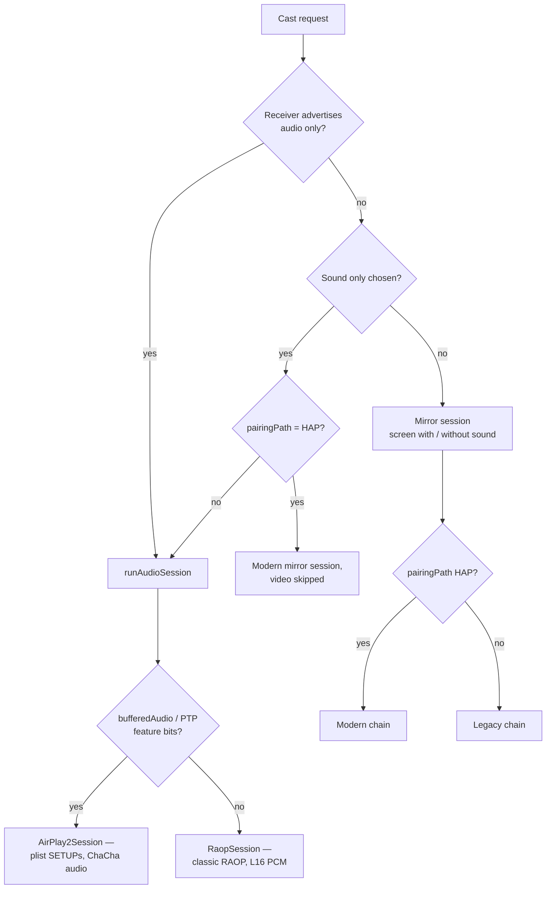
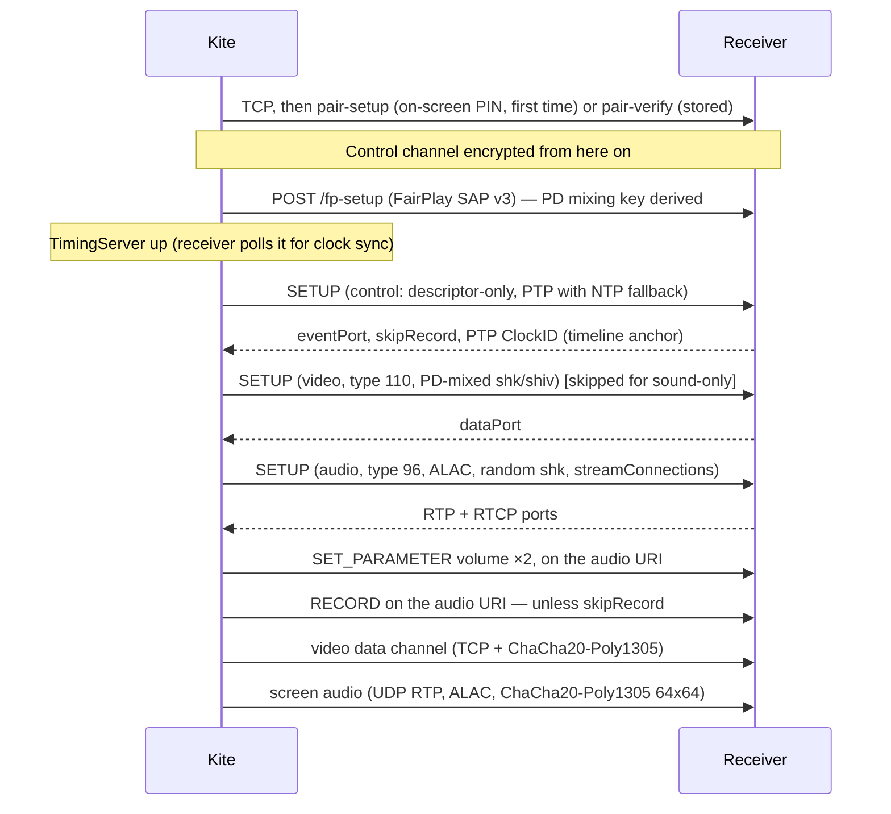
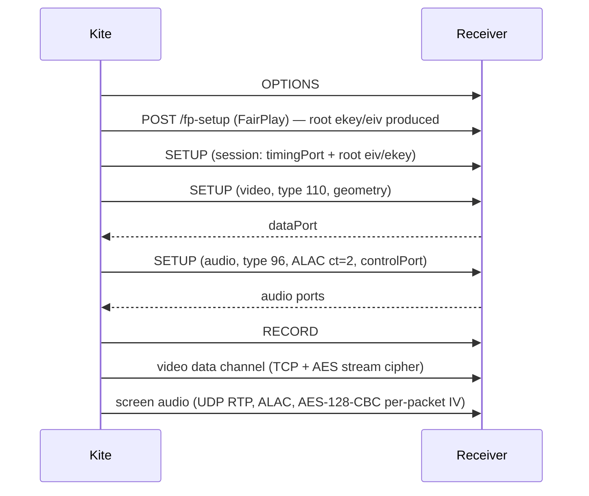

# Contributing to Kite

Thanks for your interest in Kite — an Android AirPlay **sender** that mirrors
the phone's screen and plays its audio on AirPlay receivers (Macs, Apple TVs,
UxPlay, and similar). This guide covers the repository layout, the casting
architecture you will be working in, and the rules that keep the protocol code
correct.

---

## Table of Contents

- [Repository structure](#repository-structure)
- [Build and test commands](#build-and-test-commands)
- [Casting architecture](#casting-architecture)
  - [Cast-mode routing](#cast-mode-routing)
  - [The modern mirror chain](#the-modern-mirror-chain-macos--apple-tv)
  - [The legacy mirror chain](#the-legacy-mirror-chain-uxplay-and-similar)
  - [Audio-only chains](#audio-only-chains)
  - [Media pipelines](#media-pipelines)
  - [Crypto and key material](#crypto-and-key-material)
  - [Discovery](#discovery)
- [Commit conventions](#commit-conventions)
- [Development rules](#development-rules)
- [Testing](#testing)
- [Before opening a pull request](#before-opening-a-pull-request)
- [File locations](#file-locations)
- [Code style](#code-style)
- [Reporting issues](#reporting-issues)
- [License](#license)

---

## Repository Structure

```
/
├── airplay/                      # Protocol module — pure Kotlin, JVM-testable
│   └── src/main/java/com/henry/kite/airplay/
│       ├── crypto/               # ChaCha20-Poly1305 (both layouts), HKDF-SHA512, SRP-6a
│       ├── discovery/            # JmDNS + BLE beacon discovery, feature flags
│       ├── pairing/              # HAP pair-setup / pair-verify, TLV8, legacy pairing
│       ├── plist/                # Binary plist reader + writer
│       ├── rtsp/                 # RTSP client, digest auth, encrypted channel
│       └── session/              # Session orchestration and stream layers
├── capture/                      # MediaProjection → H.264; AudioRecord → AAC/ALAC
├── app/                          # Compose UI, MirrorService (FGS), settings, tile, logs
└── images/                       # README screenshots
```

`airplay` and `capture` do not depend on each other; the `app` module wires
encoded frames from one into the other.

---

## Build and Test Commands

```sh
./gradlew :app:assembleDebug     # build the APK
./gradlew test detekt            # all JVM unit tests + static analysis
./gradlew :airplay:testDebugUnitTest --tests "com.henry.kite.airplay.crypto.*"
adb install -r app/build/outputs/apk/debug/app-debug.apk
```

Use a real device: emulators cannot capture a screen and cannot exercise
mDNS/BLE discovery.

---

## Casting Architecture

### Cast-mode routing

`MirrorService.handleStart` picks exactly one chain per cast. The choice depends
on the user's cast mode (long-press menu) and the receiver's advertised
capabilities:



| Chain | Receiver | Session class | Audio pipeline |
|-------|----------|---------------|----------------|
| Modern mirror | macOS, Apple TV (HAP) | `MirrorSession` + `ModernSessionSetup` | `AlacAudioEncoder` → `ModernAudioStream` |
| Legacy mirror | UxPlay, other open receivers | `MirrorSession` + `setupLegacySession` | `AlacAudioEncoder` → `AudioStream` |
| Sound-only (HAP) | macOS | `MirrorSession`, `videoEnabled=false` | same as modern mirror |
| AirPlay 2 audio-only | HomePod-class (bufferedAudio/PTP bits) | `AirPlay2Session` | `AlacAudioEncoder` |
| RAOP audio-only | classic AirPlay 1 receivers | `RaopSession` | `AudioPcmSource` (L16) |

Two routing consequences worth knowing:

- **Sound-only on macOS runs the mirror chain with video skipped.** macOS does
  not accept a standalone audio session from us (the audio SETUP is rejected);
  the screen-audio stream it does accept lives inside a mirroring session.
- **A receiver that only advertises audio never takes a mirror session**, even
  for a plain cast — it goes straight to `runAudioSession`.

### The modern mirror chain (macOS / Apple TV)

For HAP receivers the order is protocol-significant: macOS answers 403 to every
request from an unpaired client (OPTIONS and fp-setup included), so pairing
runs before anything else and everything after travels on the encrypted control
channel.



Each response seeds the next step: `eventPort` opens the event channel,
`skipRecord` decides the RECORD, `ClockID` + the private timestamp headers
anchor the media clock onto the receiver's PTP timeline, and the audio SETUP's
`streamConnections` carry the ports the audio stream dials. Do not reorder
phases or introduce conditional skips beyond `videoEnabled`.

### The legacy mirror chain (UxPlay and similar)



Differences from the modern chain: the FairPlay root material rides in the
session SETUP, the control channel stays plaintext (unless the receiver asks
for HAP pairing or a Digest password), video uses the legacy AES cipher derived
from the FairPlay key, and the audio stream sends its own 1 Hz clock-sync
packets to the receiver's control port.

### Audio-only chains

- **`RaopSession`** — classic RAOP: OPTIONS → ANNOUNCE (SDP, L16 44.1 kHz
  stereo) → SETUP → RECORD. The AES key is RSA-wrapped for the receiver
  (`RaopRsa.kt`), audio is L16 PCM in 352-sample frames, per-packet AES-128-CBC
  IV, clock sync via 0xd4 packets. Some AirPort/Sonos-class devices require an
  `/auth-setup` preamble before ANNOUNCE.
- **`AirPlay2Session`** — the plist session flow for HomePod-class receivers:
  pair-verify (stored credentials or the on-screen PIN) → control SETUP →
  encrypted event channel → audio SETUP with a `shk` from the descriptor →
  ChaCha20-Poly1305 audio. No FairPlay involved.

### Media Pipelines

**Video** (all mirror chains):

```
MediaProjection → VirtualDisplay (sized by Settings ▸ Resolution)
  → MediaCodec H.264 (VBR, explicit "max-bitrate", AVCLevel52 → 4.1 fallback)
  → NaluRepacker (avcC codec config first, then length-prefixed slices)
  → MirrorStream (128-byte mirroring header per frame; MirrorPacket)
  → cipher (modern: ChaCha20-Poly1305; legacy: AES) → TCP
```

The first packet of the channel is the codec config (SPS/PPS in avcC form);
slices before it are dropped by receivers. Rotation rebuilds the encoder,
resizes the VirtualDisplay and re-sends the codec config.

**Audio** (mirror chains): `AudioPlaybackCaptureConfiguration` (the same
MediaProjection as video) → `AudioRecord` → `AlacEncoder` (pure-software
44.1 kHz/16-bit stereo, 352-sample frames) → per chain:

- Modern: `ModernAudioStream` — RTP PT 0x60, SSRC=0, RTP step 352 samples,
  each frame re-sent as `[N-2, N-1, N]`, draft-agl ChaCha20-Poly1305, 
  TimeAnnounce (PT 0xd7) at the first frame and once per second, 0xd5/0xd6
  retransmit responses.
- Legacy: `AudioStream` — RTP with the ALAC payload type, AES-128-CBC with a
  per-packet IV reset, 1 Hz 0xd4 clock sync to the receiver's control port.

Legacy receivers get **ALAC (ct=2)**, not AAC-ELD: receivers validate ELD
frame headers against Apple-encoder first bytes and drop frames from other
encoders. The audio encoder is only created when RECORD_AUDIO is granted and a
stream exists — otherwise the session runs video-only.

### Crypto and Key Material

| Material | Established by | Consumed by |
|----------|----------------|-------------|
| Video channel key (modern) | HKDF-SHA512(pair-verify shared secret, salt `"DataStream-Salt<connectionId>"`, info `"DataStream-Output-Encryption-Key"`) | `ChaChaFrameCipher` — IETF ChaCha20-Poly1305, 12-byte nonce |
| Video/audio stream keys (legacy) | FairPlay `fp-setup` → `StreamCipher` | `MirrorStream`, `AudioStream` (AES) |
| Screen-audio key (modern) | random 32-byte `shk` published in the audio SETUP descriptor | `ModernAudioStream` — `OriginalChaCha20Poly1305` (draft-agl 64x64: 8-byte LE nonce appended after the tag, AAD = RTP timestamp + SSRC) |
| Event channel (modern) | HKDF-SHA512 of the pair-verify shared secret | `EventChannel` |
| Pairing | SRP-6a / Ed25519 / X25519 | HAP flows (`pairing/`, `crypto/`) |

Rules:

- Key derivation happens at the phase that establishes it and nowhere else.
- Crypto code is validated with golden vectors produced by the implementation
  the receivers interoperate with (`github.com/aead/chacha20poly1305` for the
  audio AEAD, doubletake's Go tests for FairPlay). Self-consistent
  implementations can agree with each other and still disagree with every
  receiver — only interop vectors count.
- Regenerate vectors offline from a doubletake clone (its `go.sum` resolves the
  modules from the Go module cache):

```sh
GOFLAGS=-mod=mod GOPROXY=off go run ./tmpdir
```

### Discovery

- **mDNS** (`ReceiverDiscovery`, JmDNS): browses `_airplay._tcp` and
  `_raop._tcp`. Capabilities come from the `features` TXT bitmask
  (`FeatureFlags`). Merging rules: one receiver = one entry, keyed by
  `host:port` (never `stableId`/`deviceid`); IPv4 supersedes IPv6 for the same
  deviceId; `_raop` presence marks a receiver as audio-capable.
- `_raop` resolve callbacks do not fire reliably — audio-only capability is
  detected by recording `_raop` instance names at `serviceAdded` and matching
  the `_airplay` TXT `deviceid` against them (strip `:` from both sides).
- **BLE** (`BleBeaconScanner`): parses Apple manufacturer data (company
  `0x004C`, type `0x09`) carrying IPv4 + port. Entries appear only after
  `GET /info` enrichment succeeds **and** the receiver advertises screen
  mirroring — unconfirmed entries stay hidden, and mDNS wins duplicates.

---

## Commit Conventions

Use [Conventional Commits](https://www.conventionalcommits.org/):

```
<type>(<scope>): <subject>
```

**Types**: `feat`, `fix`, `docs`, `style`, `refactor`, `perf`, `test`,
`chore`, `revert`

**Examples**:

```
feat(app): add video-only option to the long-press menu
fix(airplay): use the per-frame nonce when sealing screen audio
docs(readme): rewrite the acknowledgements section
```

---

## Development Rules

1. **Wire-format changes ship with their pinning test.** All RTSP bodies are
   built in `SetupRequests.kt` / `ModernSetupRequests.kt` and parsed back in
   `SetupRequestsTest`. Plists, RTP framing and crypto layouts follow the same
   principle — see [Testing](#testing) for the test map.
2. **Ports stay 1:1 with their reference.** Ported files cite the Go function
   they mirror; keep the structure. Prefer `@Suppress("RuleName")` at the site
   over restructuring; refactor a port only while a golden vector proves
   equivalence.
3. **Every user-visible string ships in all 11 locales**: `values/` plus
   `values-de`, `-es`, `-fr`, `-it`, `-ja`, `-ko`, `-pt-rBR`, `-ru`, `-zh-rCN`,
   `-zh-rTW`. Terse copy, strict Material 3.
4. **detekt gates the build.** detekt 2.0-alpha with `autoCorrect=true`; its
   baseline signatures are not guessable, so suppress at the declaration with a
   one-line reason.
5. **Bit-rate bounds span two modules.** `MirrorSettings.BIT_RATE_MAX_MBPS`
   (slider) and `VideoFormat.BIT_RATE_MAX_BPS` (encoder `require()`) must agree;
   `MirrorSettingsTest` asserts it.
6. **Cleanup never runs on the main thread.** Streams close their sockets
   before any flush, and a receiver-initiated disconnect goes through
   `MirrorSession.onConnectionLost` → `SessionState.Failed` — never let an
   `IOException` escape a feedback coroutine.

---

## Testing

```sh
./gradlew test                   # every JVM unit test
./gradlew detekt                 # static analysis
```

| Test | Pins |
|------|------|
| `SetupRequestsTest` | Every SETUP descriptor field (ct, spf, audioFormat bit, shk size, streamConnections shapes), parsed back through `BinaryPlistReader` |
| `FpsapTest`, `FairplayPrimitiveTest` | FairPlay SAP v3 golden vectors |
| `OriginalChaCha20Poly1305Test` | Audio AEAD against `github.com/aead/chacha20poly1305` vectors |
| `AlacEncoderTest` | Bit-exact ALAC frames vs doubletake's Go encoder |
| `BinaryPlistWriterTest` | Bplist trailer and object layout (Apple's parser reads the last 32 bytes strictly) |
| `VideoFormatTest`, `MirrorSettingsTest` | Encoder bounds and slider↔encoder consistency |

Audio/video behaviour additionally needs a manual smoke test against a real
receiver — a Mac on the LAN or UxPlay. **Audio counts as tested only when
someone heard sound.** Useful log filters:

```sh
adb logcat -s PairSetup:I PairVerify:I MirrorSession:I RtspClient:I \
  ModernSessionSetup:I ModernAudioStream:I AirPlay2Session:I
```

### CI

Three GitHub Actions tracks, one per lifecycle stage:

| Trigger | Workflow | What it builds |
|---------|----------|----------------|
| Pull request into `main` | `pr-check.yml` | detekt, Android Lint, unit tests, **debug APK** (debug signing); failures are posted as PR comments with the full logs |
| Push to `main` | `canary.yml` | **signed canary** (`1.0.0-canary.N`, the release keystore from repository secrets); the APK is uploaded as a workflow artifact |
| Tag `v*` | `release.yml` | **signed release**; creates the GitHub Release with the APK attached |

Releasing is the tag push: bump `versionCode`/`versionName` in
`app/build.gradle.kts` (the tag must match the versionName), merge to `main`,
then `git tag v1.0.1 && git push origin v1.0.1`. The README release badge
updates by itself.

---


## Before Opening a Pull Request

1. `./gradlew test detekt :app:assembleDebug` — must be green.
2. For audio/video changes: install on a device, cast to a real receiver, and
   confirm the expected `[SETUP]` / `[AUDIO-TX]` log lines.
3. New strings: all 11 locales.
4. Describe what you tested against (which Mac / Apple TV model / UxPlay
   build) in the PR description.

---

## File Locations

| Area | Path |
|------|------|
| Audio crypto (draft-agl AEAD) | `airplay/…/crypto/OriginalChaCha20Poly1305.kt` |
| Video channel crypto | `airplay/…/session/ChaChaFrameCipher.kt` |
| FairPlay SAP v3 | `airplay/…/session/Fairplay*.kt`, `FpsapSession.kt` |
| Pairing (HAP + legacy) | `airplay/…/pairing/` |
| SETUP bodies | `airplay/…/session/SetupRequests.kt`, `ModernSetupRequests` |
| Session orchestration | `airplay/…/session/MirrorSession.kt` |
| Video stream + framing | `airplay/…/session/MirrorStream.kt`, `MirrorPacket.kt`, `NaluRepacker.kt` |
| Legacy audio stream | `airplay/…/session/AudioStream.kt` |
| Modern audio stream | `airplay/…/session/ModernAudioStream.kt` |
| Screen capture / encode | `capture/…/ScreenEncoder.kt` |
| ALAC encode | `capture/…/AlacEncoder.kt`, `AlacAudioEncoder.kt` |
| Service | `app/…/service/MirrorService.kt` |
| Settings model | `app/…/settings/MirrorSettings.kt`, `SettingsRepository.kt` |
| Localization | `app/src/main/res/values*/strings.xml` |

---

## Code Style

- Follow the project's detekt configuration (includes the ktlint wrapper);
  `./gradlew detekt` must pass.
- Naming: types and composables `PascalCase`; functions and variables
  `camelCase`; constants `UPPER_CASE`.
- Comments state *why* (constraints, protocol provenance), not what the next
  line does. Ported code names the Go function it mirrors.
- Kotlin operator precedence: `and` / `or` / `shl` bind lower than `+` / `-` —
  parenthesize ported bit math.
- Protocol constants (ct values, spf, bit offsets) live in named constants with
  a comment naming their source; no inline magic numbers.

---

## Reporting Issues

Include:

- what you cast to (receiver type and model, e.g. MacBook Air / Apple TV 4K /
  UxPlay on Windows),
- the log bundle from the app: **Settings → Logs → share**,
- what you expected and what happened instead.

---

## License

Kite is released under the GNU LGPL-3.0 (see `LICENSE`). By contributing you
agree that your changes are licensed under the same terms. Ported files keep
their original attribution — see the acknowledgements in the README.
