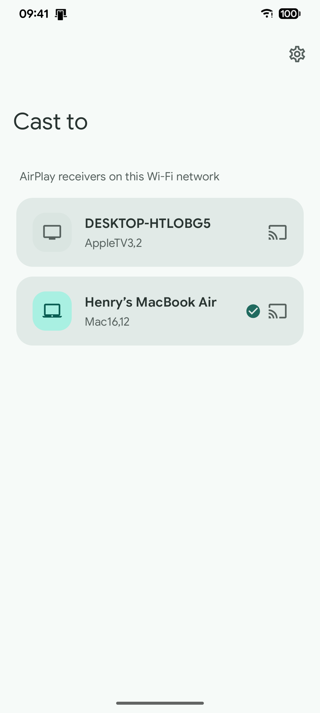
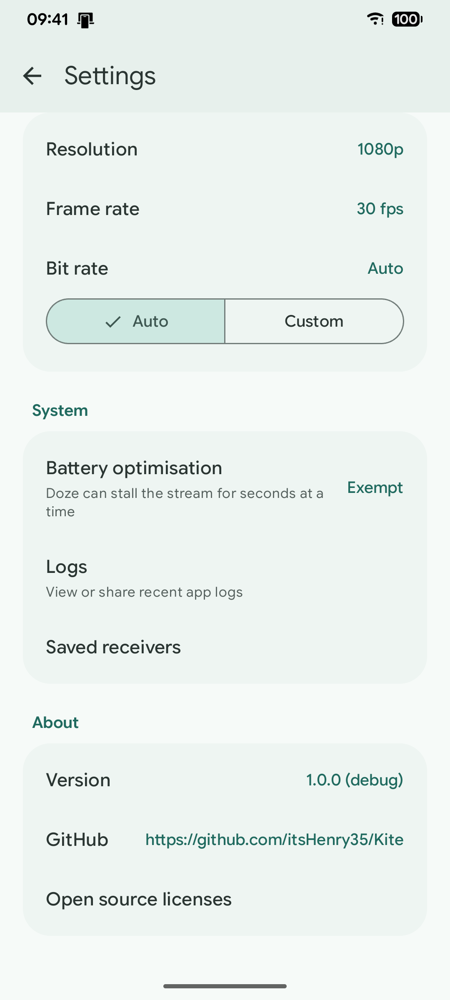

# Kite

Android 上的 AirPlay 发送端 —— 把手机屏幕（和声音）投到 Mac、Apple TV 或任何
AirPlay 接收端。

[English](README.md) | 简体中文

## 发行版

[](https://github.com/itsHenry35/Kite/releases)

## 截图

<p align="center">
  
  
</p>

## 功能

- 把手机屏幕投到 Mac、Apple TV 或任何 AirPlay 接收端
- 声音同播：长按接收端选择 画面和声音 / 仅画面 / 仅声音
- Mac 和 Apple TV 首次输入屏幕上的 PIN，之后每次连接自动完成
- 分辨率 / 帧率 / 码率可调，码率最高 200 Mbps
- 自动发现同一 Wi-Fi 下的接收端，也兼容 UxPlay 等开源接收端
- 快捷设置磁贴、一键分享日志

## 要求

- Android 10 及以上（minSdk 29）
- 一台与接收端处于同一 Wi-Fi 网络的真实设备
- AirPlay 接收端

## 构建

```sh
./gradlew :app:assembleDebug
```

## 致谢

Kite 建立在多年开源 AirPlay 工作之上。感谢：

- [doubletake](https://github.com/omarroth/doubletake) —— Go 实现的 AirPlay
  发送端；Kite 的部分代码移植自该项目
- [UxPlay](https://github.com/FDH2/UxPlay) —— 开源 AirPlay 接收端；开发过程中
  的主要参考
- [pyatv](https://github.com/postlund/pyatv) —— AirPlay 2 协议参考
- [shairport-sync](https://github.com/mikebrady/shairport-sync) —— 配对与时间
  同步参考
- [openairplay](https://github.com/openairplay/airplay-spec) —— 早期协议文档

## 许可

Kite 以 GNU LGPL-3.0 发布，见 [LICENSE](LICENSE)。移植代码沿用 doubletake 的
许可。开源声明也可在应用内「设置 → 关于」中查看。
